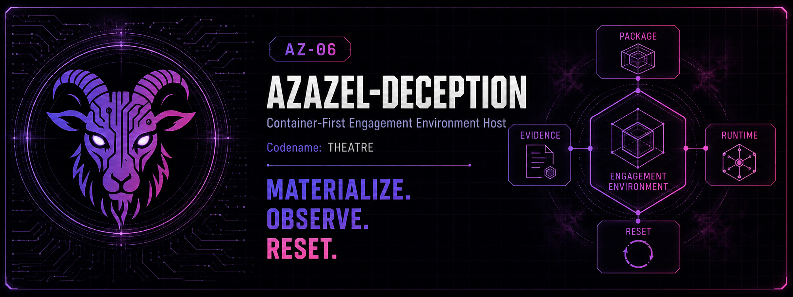

# AZ-06 Azazel-Deception - Container-First Engagement Environment Host



> **Codename:** `THEATRE`

Azazel-Deception is **AZ-06 Azazel-Deception Host**, the attacker-facing Engagement Environment Plane of the Azazel series.

It materializes bounded, coherent deception environments from versioned packages after approval by Azazel-Edge. It is a portable, capability-aware, container-first runtime: Raspberry Pi 5 is a minimum reference host, not a product constraint.

> Engage expresses intent. Knowledge advises. Fabric describes. Edge decides and enforces. Deception Host materializes, transitions, records, and resets.

## Status

**Phase 0 complete; Phase 1 in progress.** The AZ-06 designation is ratified and the canonical Azazel-Fabric deception-environment contracts are landed. Live engagement remains **disabled by default** and stays that way until the Phase-1 live gates close — including physical/hardware-in-the-loop isolation gates that no CI run can satisfy. Per-item status is in [`docs/roadmap.md`](docs/roadmap.md), [`docs/implementation-status.md`](docs/implementation-status.md) and [`docs/live-gate-checklist.md`](docs/live-gate-checklist.md).

Versions (details in [`docs/fabric-pin.md`](docs/fabric-pin.md)):

- **Product version:** see the `version` field in [`pyproject.toml`](pyproject.toml). It is a pre-release development version. Release state (no stable release, no release tag, work in progress under `[Unreleased]`) is recorded in [`CHANGELOG.md`](CHANGELOG.md).
- **Fabric pin:** the exact `azazel-fabric` tag is declared in [`pyproject.toml`](pyproject.toml). It is pinned to an exact tag, never a branch, and the version/pin policy (including the candidate status and when the pin is revisited) is set out in [`docs/fabric-pin.md`](docs/fabric-pin.md).

Hardware-in-the-loop evidence does not exist yet. Container, virtual-lab and CI results are software evidence only; they do not close any HIL gate.

A read-only package and host check is described in [Install and verify](#install-and-verify); it does not activate an environment.

Initial portability target:

- OCI containers
- `linux/arm64` and `linux/amd64`
- Docker Compose reference adapter
- static Linux deception package
- deterministic package validation, lifecycle, evidence, and reset semantics
- no GPU, KVM, Kubernetes, or online LLM requirement

Implemented today: host capability discovery, fail-closed package validation with a normalize-first canonical content digest, deterministic non-executing placement planning, a synthetic Linux reference package on an immutable multi-architecture image digest, isolated Compose assets with a static isolation policy, a gated Compose lifecycle adapter (default-off), a tamper-evident evidence chain, authenticated one-shot Edge decision handling, an operator kill switch, an Edge shadow/replay boundary, native ARM64/AMD64 portability CI, tests, and safety/integration documentation. These are software properties; they are not field or HIL certification.

## Responsibility boundary

Azazel-Deception owns:

- host capability discovery
- validation and materialization of already-approved deception packages
- isolated decoy services, files, credentials, personas, and bounded activity runtime
- execution of approved finite-state transitions
- interaction evidence export
- deterministic reset and credential invalidation

Azazel-Deception does **not** own:

- final engagement decisions or route enforcement — Azazel-Edge owns those
- shared wire-contract authority — Azazel-Fabric owns those contracts
- effectiveness scoring or posture authority — Azazel-Knowledge remains advisory-only
- unrestricted autonomous planning
- hack-back, attacker-system compromise, arbitrary code delivery, or uncontrolled decoy egress
- runtime LLM authority

## Authority: three different things

Three things are easy to conflate. They are different in kind:

| Thing | What it is | What it can do |
|---|---|---|
| MIO objective (observation objective) | Advice, carried as `advisory:` references | Nothing. It starts, selects, extends and ends nothing. |
| Edge decision | The **sole authorization** for activation or transition | Must be authenticated, unexpired, unconsumed and correctly bound. The operator kill switch can terminate/reset; it cannot activate an environment. |
| Deception execution and observation boundary | Deception executes only Edge-approved decisions through its adapter, and records what it observed | Materializes, transitions, records and resets within the decision's window. It does not decide, and an observation is never a decision. |

An objective can be listed in an Edge decision's `evidence_refs`; that binds
it to the signature, and it still authorizes nothing. The full binding rules,
lease, and feedback bundle are in
[`docs/mio-objective-feedback.md`](docs/mio-objective-feedback.md).

## Architecture

```text
Azazel-Knowledge Advisor
        | advisory-only context
        v
Azazel-Edge Gateway
  deterministic approval / routing / budgets / termination
        | signed, versioned decision
        v
Azazel-Deception Host
  package validation / capability match / runtime adapter / evidence / reset
        | measured outcomes
        v
Azazel-Knowledge Advisor
```

Within AZ-06:

```text
DeceptionPackage
      |
      v
Package Validator ---- Host Capabilities
      |                     |
      +----------+----------+
                 v
          Placement Planner
                 |
                 v
          Runtime Adapter
          Docker Compose
                 |
                 v
       Isolated Decoy Runtime
                 |
                 v
       Evidence + Reset Result
```

## Deployment tiers

| Tier | Reference host | Intended use |
|---|---|---|
| `lite` | Raspberry Pi 5 / ARM64 SBC | one small static Linux environment |
| `standard` | N100/N305-class x86 mini PC | multiple containers and richer deterministic environments |
| `heavy` | KVM-capable x86 host | later VM-capable and multi-segment environments |
| `cluster` | multiple nodes | future work; not part of the initial implementation |

Packages declare required capabilities and explicitly optional components. Missing required capabilities fail closed; AZ-06 never silently weakens isolation or required narrative components.

## LLM policy

LLM use is optional and preparation-oriented. It may help draft narratives, synthetic documents, personas, or package content before deployment. Any AI-generated material must be validated, frozen, versioned, and signed before activation.

Approved packages remain fully executable with **no LLM available at runtime**. An LLM never selects an engagement, opens a port, changes routing, authorizes a transition, or mutates a live environment autonomously.

## Safety invariants

- no route from decoy workloads to protected production assets
- decoy egress denied by default
- no real credentials, personal data, secrets, or production artifacts in reference packages
- explicit duration, CPU, memory, storage, connection, and traffic budgets
- fail closed on unsupported schema, capability mismatch, invalid provenance, stale decision, or inconsistent narrative
- operator-visible lifecycle and manual termination
- evidence-preserving deterministic teardown and reset
- Docker socket, Edge control APIs, and host privileged interfaces are never exposed to attacker-facing workloads

See [`docs/safety-model.md`](docs/safety-model.md).

## Install and verify

Use Python 3.10 or later in a virtual environment. Installing pulls `azazel-fabric` from GitHub at the
exact tag declared in [`pyproject.toml`](pyproject.toml) (policy in
[`docs/fabric-pin.md`](docs/fabric-pin.md)), so this step needs network access and `git`.

```bash
python -m venv .venv
. .venv/bin/activate
pip install -e '.[dev]'
pytest
```

`pytest` runs the deterministic test suite. Real-container tests are opt-in and
are not part of a plain `pytest` run: they require `AZAZEL_DECEPTION_DOCKER_TESTS=1`
and Docker Engine with the Compose v2 plugin.

Minimal read-only checks of the non-executing bootstrap CLI, using the
reference package:

```bash
python -m azazel_deception capabilities
python -m azazel_deception validate examples/packages/municipal-linux-v1/package.yaml
```

The same commands are also available as the installed `azazel-deception`
script. The `validate` command exits non-zero on an invalid package.

## Shadow/replay and the live Compose path

These two are separate and must not be confused:

- **Shadow / replay (non-executing).** The Edge shadow/replay boundary is
  non-executing. AZ-06's default mode is `planned_shadow`, which starts no
  runtime.
- **Live Compose lifecycle (gated, default-off).** The Docker Compose adapter
  can start and stop an environment, but only through a gated path that is
  **off by default**. Having the adapter is not the same as enabling exposure.
  Enabling it requires the Phase-1 live gates to close, including the HIL
  gates above. The combined networked Edge→AZ-06 flow remains open; see
  [the live-flip runbook](docs/live-flip-runbook.md) and
  [Edge issue #325](https://github.com/01rabbit/Azazel-Edge/issues/325).

## Bootstrap CLI

The initial CLI is intentionally non-executing. It reports host capabilities, validates the bootstrap reference package, and produces a deterministic placement plan while the Fabric and Edge activation contracts stabilize.

```bash
python -m azazel_deception capabilities
python -m azazel_deception validate examples/packages/municipal-linux-v1/package.yaml
python -m azazel_deception plan examples/packages/municipal-linux-v1/package.yaml

# Canonical package integrity (representation-invariant, normalize-first):
python -m azazel_deception digest examples/packages/municipal-linux-v1/package.yaml
python -m azazel_deception canonical-payload examples/packages/municipal-linux-v1/package.yaml
python -m azazel_deception seal examples/packages/municipal-linux-v1/package.yaml   # emits sealed package to stdout
```

The `plan` command produces a descriptive placement plan only. It does not start containers and carries no activation authority.

`package_digest` is a deterministic semantic content digest computed from the normalized Fabric model (never the raw YAML), so the same meaning hashes identically across raw dict, model, YAML reload, and JSON round-trip. `seal` stamps that digest at authoring time and never rewrites the source in place; `validate` verifies it fail-closed. The detached `signature_ref` locator is excluded from the digest so an attestation reference can be rotated after signing.

## Repository layout

```text
src/azazel_deception/       bootstrap control-plane code
runtime/compose/            reference Docker Compose adapter assets
examples/packages/          deterministic reference deception packages
scripts/dev/                developer/verification tooling (preflight, compose smoke, virtual lab)
docs/                       architecture, safety, contracts, integration, roadmap, traceability
tests/                      deterministic bootstrap tests
```

Notable changes are recorded in [`CHANGELOG.md`](CHANGELOG.md).

## Design traceability

The requirements inherited from the Azazel-series issues are mapped in [`docs/source-traceability.md`](docs/source-traceability.md). This records which doctrine, Fabric, Edge, Knowledge, and Gadget issues produced each AZ-06 responsibility and safety invariant.

Primary cross-repository dependencies:

- Doctrine / parent: `01rabbit/Azazel#61`
- Engage system model: `01rabbit/Azazel#60`
- Shared contracts: `01rabbit/Azazel-Fabric#9` and `#8`
- Edge authority / activation: `01rabbit/Azazel-Edge#325` and `#319`
- Effectiveness analysis: `01rabbit/Azazel-Knowledge#58` and `#52`
- Gadget fixed-profile compatibility boundary: `01rabbit/Azazel-Gadget#17` and `#16`

## Implementation trackers

Issue states below were last read from GitHub on 2026-09-19 and were **not re-read** for this revision. Check each tracker link for its current state before routing work to it.

| Open issue | Purpose |
|---|---|
| [#3](https://github.com/01rabbit/Azazel-Deception/issues/3) | Prove one signed reference package on ARM64 and AMD64 — reviewed SBOM-content policy and equivalent end-to-end lifecycle on both architectures remain open |
| [#28](https://github.com/01rabbit/Azazel-Deception/issues/28) | Separate Deception lifecycle state from Edge/Gadget Defensive State |
| [#30](https://github.com/01rabbit/Azazel-Deception/issues/30) | Research: Deception as a Presented Terrain engine with transition, fingerprint, and outcome-evidence discipline |
| [#31](https://github.com/01rabbit/Azazel-Deception/issues/31) | Static Presented Terrain vertical slice — the v0 slice is delivered and CI-green; the issue tracks the adaptive/fingerprint/benchmark follow-ons its body excludes |
| [#35](https://github.com/01rabbit/Azazel-Deception/issues/35) | Reconcile AZ-06 assurance evidence and define bounded Nexus/Boot Lite profiles |
| [#6](https://github.com/01rabbit/Azazel-Deception/issues/6) | Phase 2 coherent narrative, honey artifacts, credentials, personas, and finite-state transitions — **gated, not started** |

Closed, kept only as history: [#1](https://github.com/01rabbit/Azazel-Deception/issues/1) (canonical Fabric contracts), [#2](https://github.com/01rabbit/Azazel-Deception/issues/2) (feature-disabled Compose lifecycle adapter), [#4](https://github.com/01rabbit/Azazel-Deception/issues/4) (isolation/evidence/termination/reset harness), [#5](https://github.com/01rabbit/Azazel-Deception/issues/5) (Edge shadow/replay integration). Closing them did **not** close the hardware-in-the-loop gates; those remain open in [`docs/live-gate-checklist.md`](docs/live-gate-checklist.md).

The remaining order is **#3 → live Phase 1 gate → #6**, with #28/#30/#31 running alongside. Live exposure must not be enabled merely because a runtime adapter can start containers, and Phase 2 must not begin merely because CI is green.

## Phase order

1. Phase 0 — canonical contracts, threat model, isolation, provenance, golden fixtures, dry-run only.
2. Phase 1 — one static coherent Linux environment on ARM64 and AMD64, behind explicit Edge authorization and feature gates.
3. Phase 2 — coherent honey artifacts, decoy-only credentials, deterministic personas, and Edge-approved finite-state transitions.
4. Phase 3 — Knowledge effectiveness loop, advisory-only.
5. Phase 4 — additional Linux/Windows/OT/IoT environment classes after isolation and reset are proven.

## Claims

Use `MITRE Engage-aligned` or `Engage-informed`. This project does not claim MITRE certification or guaranteed attacker belief. Measure and report **observed interaction**, **observed reaction**, and **measured outcomes**.

## License

MIT. See [`LICENSE`](LICENSE).
